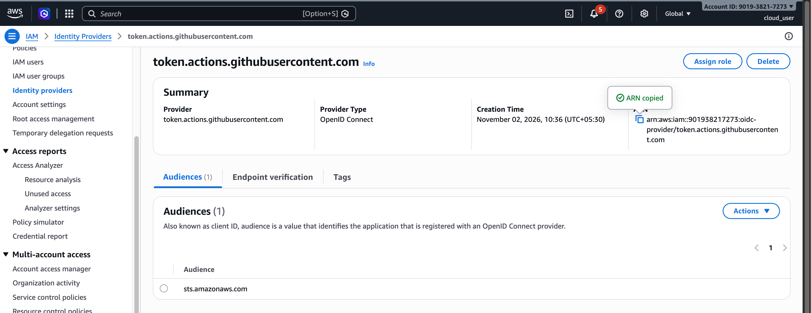

# github-actions-devops

Github actions is a CI/CD tool offered by Github.

Github actions provide image as environment ubuntu.

Github actions connect to AWS using OpenID Connect(OIDC) open standard for authentication.

Configuration supports using YAML

Pipeline starts with name ex. CICD Pipeline or workflow

`on:` is trigger `push:` push code on branch(ex.main) triggers pipeline and runs automatically.
    `pull_request` and `workflow_branch`

`jobs` `runs_on` ubuntu latest environmet.

`steps` 

inside project need to create a .github/workflows/test.yaml

For keys: `setting-> secrets and variables -> create secret `

# Deployment protection rules
Add reviewers for production manual approvals otherwise automatically run the workflow job.

# Lab

## Identity Provider details
Provider URL: https://token.actions.githubusercontent.com/

Audience: sts.amazonaws.com

Default subject claim prefix
: /github-actions-devops/settings/actions/oidc-configuration

arn:aws:iam::901938217273:oidc-provider/token.actions.githubusercontent.com

{
	"Version": "2012-10-17",
	"Statement": [
		{
			"Sid": "Statement1",
			"Effect": "Allow",
			"Principal": {
				"Federated": "arn:aws:iam::ACCOUNT_ID:oidc-provider/token.actions.githubusercontent.com"
			},
			"Action": [
				"sts:AssumeRoleWithWebIdentity"
			],
			"Condition": {
				"StringEquals": {
					"token.actions.githubusercontent.com:aud": "sts.amazonaws.com"
				},
				"StringLike": {
					"token.actions.githubusercontent.com:sub": "repo:nirvana-srini@ORG_ID/github-actions-devops@REPO_ID:ref:refs/heads/main"
				}
			}
		}
	]
}

